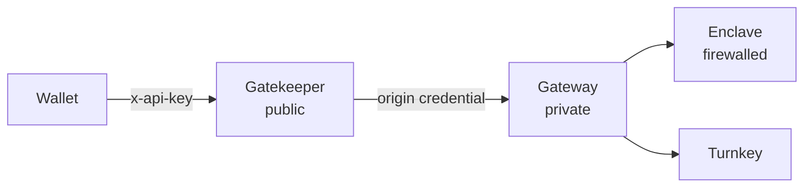
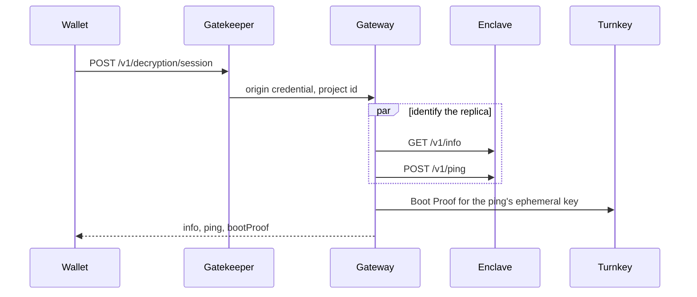
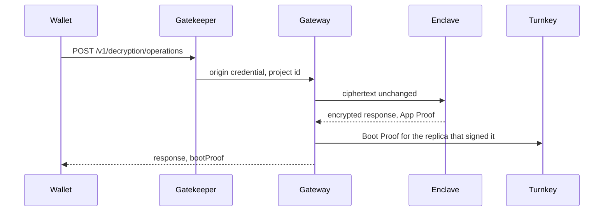
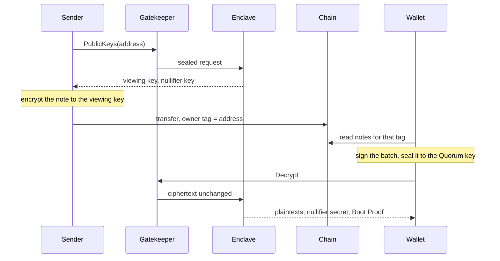

# Spec

## Contents

- [Abstract](#abstract)
- [Architecture](#architecture)
- [Glossary](#glossary)
- [Operations](#operations)
- [Establish trust before sending](#establish-trust-before-sending)
- [Send, claim, and sweep](#send-claim-and-sweep)
- [What crosses each boundary](#what-crosses-each-boundary)
- [What protects the data](#what-protects-the-data)
- [Key custody and trust](#key-custody-and-trust)

[Wire encodings](../wire/README.md) · [Test invariants](../tests/README.md) · [Release runbook](../xtask/README.md) · [Gateway contract](../gateway/openapi.json)

## Abstract

A sender can encrypt an SPR note to a Solana address before that address has a shielded wallet. The owner already has an Ed25519 key. The enclave holds a stable viewing key for the address and returns plaintext only after that owner, or a grantee they named, signs the request.

The enclave is not an internet API. A wallet calls the Helius gatekeeper. The gatekeeper checks the API key and forwards to the gateway. The gateway calls the enclave, which is firewalled, and Turnkey, which issues the replica's Boot Proof. The wallet checks that proof before it sends a note, and again on every reply.

This document specifies that path, the two operations inside the encrypted envelope, the checks a client and the enclave perform, and the custody and visibility assumptions.

## Architecture



The public hosts are `https://devnet.helius-rpc.com` and `https://mainnet.helius-rpc.com`. A wallet sends `x-api-key`, or the `api-key` query parameter. The gatekeeper resolves the Helius project and calls the gateway with `Authorization` set to the shared origin credential and `x-helius-project-id` set to that project. The committed gateway config binds `127.0.0.1:8940`.

The enclave routes are the internal interface: `GET /v1/info`, `POST /v1/ping`, `POST /v1/operations`, and `GET /health`. They take no API key. The gateway is the process that calls them. A loopback test dials the enclave directly and skips the gatekeeper, the gateway, and the Boot Proof.

A request that reaches the gateway without the gatekeeper's `Authorization` header can still present an API key. The gateway resolves the project itself. Production wallets use the gatekeeper hosts.

## Glossary

| Term | Definition |
| --- | --- |
| Gatekeeper | The public Helius edge. Admits an API key and forwards `/v1/decryption/*` to the gateway. |
| Gateway | The private process that calls the enclave and Turnkey, and stores a replay of the first answer. |
| Enclave | The decryption process inside a Turnkey Nitro replica. Holds the Quorum seed and the viewing secrets. |
| Quorum key | The release's P-256 key pair. Clients encrypt requests to its encryption half. The enclave proves it can use that key. |
| Release pin | A threshold of release authorities signs the policy. The SDK checks it before using an endpoint. |
| Boot Proof | Turnkey's Nitro attestation for one replica: COSE signature, certificate chain, PCR0–3, PCR17, and the ephemeral public key. |
| App Proof | The replica's P-256 signature over the request id, the operation, and the request and result digests. |
| Response key | A fresh P-256 key the wallet creates for one call and keeps. The enclave seals the reply to it. |
| Viewing key | X25519 key the enclave derives for one Solana address. Senders encrypt notes to the public half. |
| Nullifier secret | 31-byte spend secret for that address. An authorized decrypt returns it. The viewing secret stays inside. |
| View grant | An owner-signed window of at most 30 minutes in which a grantee may decrypt. The enclave does not store it. |
| Owner tag | The recipient's Solana address, published on the transfer so a wallet can find its notes. |

## Operations

| # | Call | Who | Result |
| --- | --- | --- | --- |
| 1 | `POST /v1/decryption/session` | Wallet, through the gatekeeper | Discovery, the signed ping, and that replica's Boot Proof |
| 2 | `POST /v1/decryption/operations` | Wallet, through the gatekeeper | The encrypted enclave response and that replica's Boot Proof |
| 3 | `PublicKeys` | Inside the encrypted envelope | Viewing public key and nullifier public key for one address |
| 4 | `Decrypt` | Inside the encrypted envelope | Plaintexts in order, and the nullifier secret |

`PublicKeys` is public in the sense that anyone who can form the envelope can ask. It still rides inside a request sealed to the Quorum key, because that is the only request the enclave accepts on `/v1/operations`. `Decrypt` additionally requires the owner's Ed25519 signature, or a grantee's signature plus the owner's grant.

The gateway forwards the operations ciphertext unchanged. It keys a replay ledger by project and ciphertext under the prefix `/v1/decryption`. The configured window is 360 seconds. A repeat returns the first answer and sets `Idempotent-Replayed: true`. The current admission limits are a 512 KiB body and 16 in-flight calls per project (`gateway/configs/config.yaml`).

The enclave's own ceiling is 10 MiB for the encrypted request and the encrypted result, the same cap as the indexer. It rejects a larger body before opening any ciphertext. The SDK splits a decrypt on the pin's ceiling, before signing. There is no item cap. The enclave has no separate in-flight limit, so concurrent connections can multiply that ceiling by the connection count.

### Session



```json
{ "version": 1, "encrypted_challenge": "<hex QOS envelope>" }
```

```json
{ "info": {}, "ping": {}, "bootProof": {} }
```

`encrypted_challenge` is a QOS envelope to the pinned Quorum encryption key. The plaintext inside it is `type = spr.tvc.qos_ping.v1`, `version`, and a random 32-byte `challenge`. The ping's App Proof signs that exact JSON.

The client stops before it sends a note when any of these fail:

1. The API key is missing or rejected (`ApiKeyRequired`, `ApiKeyInvalid`).
2. The gateway's origin credential does not match (`OriginAuthRequired`).
3. The release pin's signatures, network, or validity window fail, or discovery disagrees with the policy.
4. The ping is not a signature by the Quorum key over this challenge.
5. The Boot Proof's COSE signature or Nitro chain fails, or PCR0–3, PCR17, or the manifest digest disagree with the pin.

### Operations



```json
{
  "version": 1,
  "quorum_key_id": "<id>",
  "quorum_key_epoch": "1",
  "ciphertext": "<hex>"
}
```

```json
{ "response": {}, "bootProof": {} }
```

`response` is the enclave's `EncryptedResponse`: `version`, `request_id`, `encrypted_result`, and `tvc_app_proof`. The SDK checks the App Proof and the Boot Proof before it opens `encrypted_result` with the response private key.

The plaintext inside `ciphertext` is a `ServiceRequest`. Field layout, digest domains, and the QOS frame are in the [wire reference](../wire/README.md).

```json
{
  "version": 1,
  "request_id": "<32-byte hex>",
  "target_release_id": "<release>",
  "target_manifest_digest": "<32-byte hex>",
  "target_executable_digest": "<32-byte hex>",
  "quorum_key_id": "<id>",
  "quorum_key_epoch": "1",
  "client_response_public_key": "<65-byte SEC1 hex>",
  "operation": { "type": "PublicKeys", "address": "<base58>" }
}
```

A client opens the gatekeeper path with the release pin it trusts:

```ts
import { createGatekeeperDecryptionService } from "@heliuslabs/spr-decryption-service";

const service = createGatekeeperDecryptionService({
  network: "devnet",
  endpoint: new URL("https://devnet.helius-rpc.com"),
  apiKey,
  release,
});

const recipient = await service.address(recipientAddress);
const keys = await service.keys(owner);
```

`address` is `PublicKeys`. `keys` installs the shielded keys and does not decrypt. `keys.decrypt` is `Decrypt`.

## Establish trust before sending

An operator does not pin a URL. The release tool compares a Turnkey deployment with the reviewed image digest, the executable, the launch arguments, and the Quorum key. Operators approve that manifest and provision the Quorum key in Turnkey.

On boot, Quorum OS writes `/qos.manifest`. The envelope is QOS schema `manifest.version = "v2"` plus the approval signatures. The process refuses to start unless those approvals meet the manifest threshold, pivot debug mode is off, and the pivot environment is empty. Its arguments must be the launch arguments in the manifest, and the Quorum key it loaded must be the key the manifest names. `GET /v1/info` then reports that public key, the digest of the inner manifest, and the executable digest. The release tool checks this live replica before it writes a signed SDK pin.

The SDK checks the pin before it uses the endpoint. It verifies the authority signatures, the network, and the validity window, and it matches discovery to the policy. On mainnet the authority set, the revocation floor, the Quorum key, the security domain, and the maximum policy lifetime are pinned in the SDK. A policy cannot choose them.

The session above is how a wallet learns which replica it is talking to. The wallet cannot call the enclave or Turnkey itself. The gateway does `GET /v1/info` and `POST /v1/ping` together, then fetches the Boot Proof for the ephemeral key that signed the ping.

The replica's signing key is a separate check from the Quorum key. The SDK verifies the Boot Proof's COSE signature and the certificate chain up to the pinned AWS Nitro root. PCR0–3 must match the pinned QOS identity. The manifest digest in the attested user data must match the release policy, and PCR17 must commit to that digest and to the replica's ephemeral public key. A later call may reach a different replica, so the SDK repeats the Boot Proof check for the key that signed each reply.

The firewall and the gatekeeper are the admission path. They are operational controls. A request that reached the enclave some other way would still have to be sealed to the Quorum key, and a `Decrypt` would still have to carry a valid owner signature. `PublicKeys`, discovery, and the ping are not access-controlled beyond that seal.

## Send, claim, and sweep



### Send

A sender whose recipient has no registry record calls `PublicKeys(address)` on the service it just verified. The call returns the service viewing key and the nullifier public key. The enclave accepts on-curve Ed25519 addresses and rejects small-order keys. A program-derived address cannot authorize a decrypt.

The sender encrypts the note with an ephemeral X25519 secret and the recipient's service viewing key. The plaintext is the asset id, the amount, the blinding, and any ring or application data. The chain publishes the ciphertext, the sender's ephemeral public key, the salt, the output position, and the note commitment. The owner tag is the recipient's Solana address. The commitment binds that address and the service nullifier public key through `owner_hash`.

Senders can cache the public keys and create outputs without calling the service again. A limit on how much can be sent to an address belongs at admission, not in this service.

### Claim

The recipient wallet finds candidate outputs from the owner tag. It generates a fresh P-256 response key and keeps the private half. The signer is the owner, or a grantee named in a view grant the owner signed on a device. A grant lasts at most 30 minutes, is checked against the enclave clock, and is not stored.

The signature is a Solana off-chain message over the network, the target release and Quorum identity, a fresh request id, the ordered items, the response public key, and the grant when there is one. The SDK seals that signed request to the pinned Quorum encryption key and posts it to `/v1/decryption/operations`.

An empty batch is the same authorization, used to fetch the nullifier secret. A grantee receives that secret too. Ending the grant does not wipe a secret already returned. Spending a note still takes the owner's Solana signature.

Inside the enclave the envelope is authenticated, checked against the running release, and the Ed25519 signature is verified. With no grant, the signer address selects the viewing secret. With a grant, the grant's owner selects it. The enclave rejects the request when any of these fail:

1. The clock cannot be read, the grant window is longer than 30 minutes, or the grant names another network or Quorum key.
2. The signature, the release pin, or the response public key is missing or malformed.
3. An item names a key schedule other than `HkdfSha256Ctr`, or its ephemeral key, salt, or slot is malformed.
4. One item in the batch fails. The enclave returns no partial plaintext.

One signature covers an indexer page. The enclave seals the ordered plaintexts and the nullifier secret to the signed response key, and signs an App Proof over the request id, the operation, the request digest, and the encrypted-result digest. The SDK checks that proof, and the Boot Proof of the replica that produced it, before it opens the reply. The wallet decodes each candidate and recomputes the commitment before it accepts the note.

### Sweep

The wallet derives transaction viewing keys from the nullifier secret and moves the notes into its shielded wallet with `transact`. `merge_transact` needs the registered nullifier public key. The wallet gives the witness to its prover. For a service note that witness includes the nullifier secret. The owner signs the Solana transaction.

## What crosses each boundary

| Data | Visible to | Why |
| --- | --- | --- |
| Owner tag, ciphertext, ephemeral public key, salt, commitment | The chain and the indexer | The transfer publishes them so the wallet can find and check the note |
| API key, project id, body sizes, timing | Gatekeeper and gateway | Admission, project limits, and the replay ledger |
| Quorum key id, epoch, App Proof | Gatekeeper, gateway, and anyone who sees the request or reply | They are outside the QOS envelope |
| Note plaintext, viewing secret | The enclave, then the wallet that holds the response key | The viewing secret is derived inside the enclave and is not in the reply |
| Nullifier secret | The enclave, the authorized caller, and the prover at sweep | `Decrypt` returns it so the owner can spend |
| Quorum seed | The enclave | Every service key under this release is derived from it |

The indexer sees the wallet's queries. Deposits, withdrawals, and timing reveal more than the ciphertext does.

## What protects the data

The note on chain is X25519 between the sender and the enclave. SPR runs HKDF-SHA256 over that shared secret, both public keys, the cipher domain, the salt, and the slot, and uses the output as an AES-256-CTR key and nonce. Confidentiality needs the X25519 private keys and a fresh key and nonce for every plaintext. CTR does not authenticate a ciphertext. The wallet checks the decoded note against the published commitment before accepting it. Encrypted memos sit outside that commitment and are not trusted. `Transfer` uses the domain `TSPP/tx`. `RingDeposit` uses `TSPP/ring_deposit` and slot zero.

The request is a QOS envelope. Its AES-256-GCM key comes from ephemeral P-256 ECDH, and GCM covers the ciphertext and both public keys. Anyone can encrypt to the Quorum public key, which is why the enclave still checks the owner's signature on `Decrypt`. A v1 signature does not expire. Replaying the request at the enclave only produces another ciphertext for the original response key. The gateway's ledger returns the first of those answers.

The reply is a QOS envelope to the one-time response key. A relay cannot swap that key without breaking the owner's signature. The App Proof authenticates the reply. The response private key opens it.

The prover sees the transaction witness, and for a service note that includes the nullifier secret. The wallet is trusting the prover with it.

## Key custody and trust

The owner's Ed25519 key authorizes decrypt batches and, separately, Solana transactions. In the example that key is Turnkey. The wallet creates the response key for its own approval and has to keep the private half.

Replicas approved under the same Quorum seed derive the same service keys across releases. HKDF binds each key to the address and keeps the viewing secret and the nullifier secret apart. The viewing secret stays in the enclave. An authorized reply exports the nullifier secret. If that secret leaks, spends of known notes can be linked. A view grant hands the grantee the same secret for notes opened during the window. Spending still requires the owner's signature.

Confidentiality is the approved image, Nitro isolation, custody of the Quorum seed, and the firewall in front of the enclave. An approved image can read the seed. Whoever has the seed can open recorded requests and derive every service viewing key under it, which opens historical notes. Losing the seed makes notes that were never swept unreadable. Rotation changes the service keys, so recipients need the previous service until they sweep.
