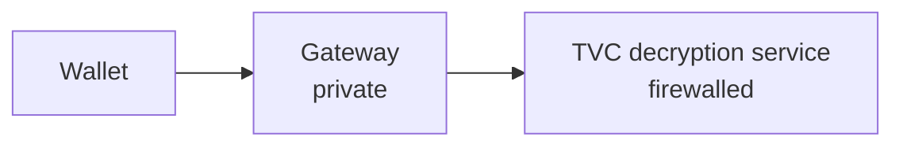
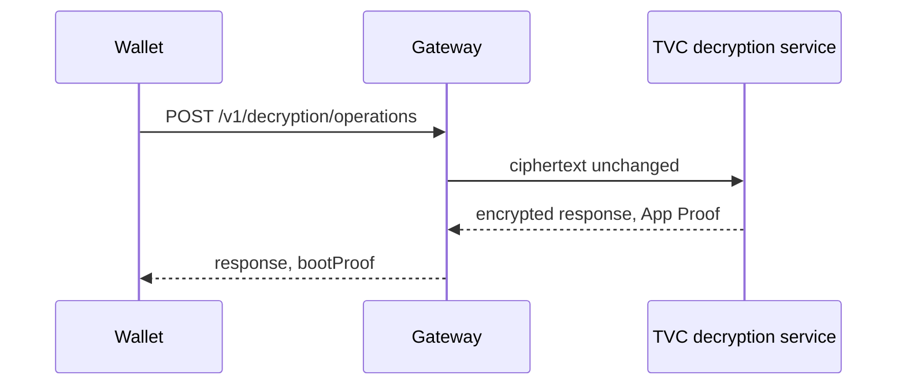
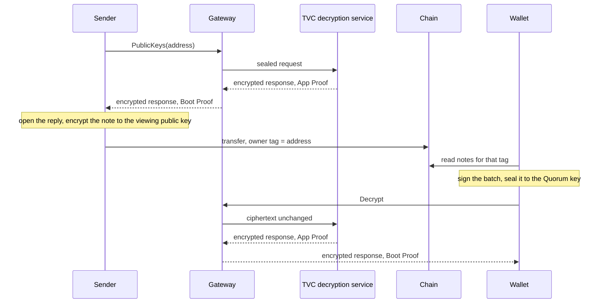
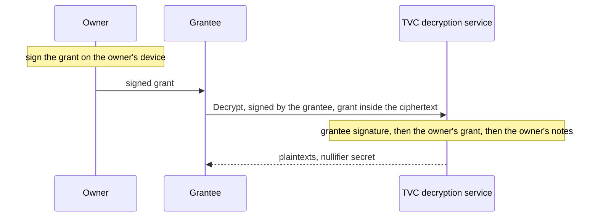
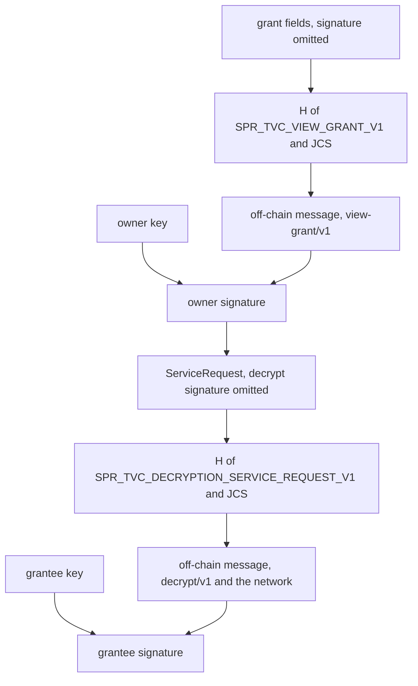

# Spec

## Contents

- [Abstract](#abstract)
- [Architecture](#architecture)
- [Glossary](#glossary)
- [Operations](#operations)
- [Establish trust before sending](#establish-trust-before-sending)
- [Send, claim, and sweep](#send-claim-and-sweep)
- [View grant](#view-grant)
- [What crosses each boundary](#what-crosses-each-boundary)
- [What protects the data](#what-protects-the-data)
- [Key custody and trust](#key-custody-and-trust)

[Wire encodings](../wire/README.md) · [Test invariants](../tests/README.md) · [Release runbook](../xtask/README.md) · [Gateway contract](../gateway/openapi.json)

## Abstract

A sender can encrypt an SPR note to a Solana address before that address has a shielded wallet. The owner already has an Ed25519 key. The enclave holds a stable viewing key for the address and returns plaintext only after that owner, or a grantee they named, signs the request.

The wallet builds each request from the signed release pin. The pin names the Quorum key, PCR0–3, and the manifest set that may approve an image. The gateway forwards the ciphertext and returns the Boot Proof of the replica that signed the reply. The wallet checks that the pinned set approved the manifest in that proof, then checks the Nitro document and the App Proof, before it opens the result. It repeats those checks on every reply. A later call may reach a replica running a newer image approved by the same set. A client release is required when the Quorum key, PCR0–3, or the manifest set changes.

This document specifies that path, the two operations inside the encrypted envelope, the checks a client and the enclave perform, and the custody and visibility assumptions.

## Architecture



The public hosts are `https://devnet.helius-rpc.com` and `https://mainnet.helius-rpc.com`. A wallet sends `x-api-key`, or the `api-key` query parameter. The gatekeeper resolves the Helius project and calls the gateway with `Authorization` set to the shared origin credential and `x-helius-project-id` set to that project. The committed gateway config binds `127.0.0.1:8940`.

The gateway calls `POST /v1/operations` and asks Turnkey for the Boot Proof of the replica that signed the reply. `GET /v1/info` and `POST /v1/ping` stay on the enclave for the release tool. A loopback test dials the enclave directly and skips the gatekeeper, the gateway, and the Boot Proof.

A request that reaches the gateway without the gatekeeper's `Authorization` header can still present an API key. The gateway resolves the project itself. Production wallets use the gatekeeper hosts.

## Glossary

| Term | Definition |
| --- | --- |
| Gatekeeper | The public Helius edge. Admits an API key and forwards `/v1/decryption/*` to the gateway. |
| Gateway | The private process that calls the enclave and Turnkey, and stores a replay of the first answer. |
| Enclave | The decryption process inside a Turnkey Nitro replica. Holds the Quorum seed and the viewing secrets. |
| Quorum key | The release's P-256 key pair. Clients encrypt requests to its encryption half. The enclave proves it can use that key. |
| Release pin | A threshold of release authorities signs the policy: the Quorum key, the namespace, the manifest set, and a minimum manifest nonce. PCR0–3 sit beside that policy. The SDK checks the signatures, the network, and the validity window before the first request, and checks each reply against the same pin. |
| Boot Proof | Turnkey's Nitro attestation for one replica, plus the QOS manifest and the manifest-set approvals. The document carries the COSE signature, certificate chain, PCR0–3, PCR17, and the ephemeral public key. |
| App Proof | The replica's P-256 signature over the request id, the operation, and the request and result digests. |
| Response key | A fresh P-256 key the wallet creates for one call and keeps. The enclave seals the reply to it. |
| Viewing key | X25519 key the enclave derives for one Solana address. Senders encrypt notes to the public half. |
| Nullifier secret | 31-byte spend secret for that address. An authorized decrypt returns it. The viewing secret stays inside. |
| View grant | An owner-signed window of at most 30 minutes in which a grantee may decrypt. The enclave keeps no copy. [View grant](#view-grant). |
| Owner tag | The recipient's Solana address, published on the transfer so a wallet can find its notes. |

## Operations

Both calls are the `operation` inside one `POST /v1/decryption/operations`. The reply is the encrypted response and that replica's Boot Proof.

| Call | Who may ask | Result |
| --- | --- | --- |
| `PublicKeys` | Anyone who can seal a request to the Quorum key | Viewing public key and nullifier public key for one address |
| `Decrypt` | The owner, or a grantee named in the owner's grant | Plaintexts in order, and the nullifier secret |

`PublicKeys` is sealed to the Quorum key, because that is the only request the service accepts on `/v1/operations`. `Decrypt` also requires the owner's Ed25519 signature, or a grantee's signature plus the owner's grant.

The gateway forwards the operations ciphertext unchanged. It keys a replay ledger by project and ciphertext under the prefix `/v1/decryption`. The configured window is 360 seconds. A repeat returns the first answer and sets `Idempotent-Replayed: true`. The current admission limits are a 512 KiB body and 16 in-flight calls per project (`gateway/configs/config.yaml`).

The enclave's own ceiling is 10 MiB for the encrypted request and the encrypted result, the same cap as the indexer. It rejects a larger body before opening any ciphertext. The SDK splits a decrypt on the pin's ceiling, before signing. There is no item cap. The enclave has no separate in-flight limit, so concurrent connections can multiply that ceiling by the connection count.

### Operations



```json
{
  "version": 1,
  "quorum_key_id": "<id>",
  "quorum_key_epoch": "1",
  "ciphertext": "<hex>"
}
```

```json
{ "response": {}, "bootProof": {} }
```

`response` is the enclave's `EncryptedResponse`: `version`, `request_id`, `encrypted_result`, and `tvc_app_proof`. The client checks the Boot Proof of `tvc_app_proof.public_key` and then the App Proof, and only then opens `encrypted_result` with the response private key. The App Proof must name this request id, this operation, this request digest, and this result digest.

The plaintext inside `ciphertext` is a `ServiceRequest`. It names the Quorum key from the pin. Field layout, digest domains, and the QOS frame are in the [wire reference](../wire/README.md).

```json
{
  "version": 1,
  "request_id": "<32-byte hex>",
  "quorum_key_id": "<id>",
  "quorum_key_epoch": "1",
  "client_response_public_key": "<65-byte SEC1 hex>",
  "operation": { "type": "PublicKeys", "address": "<base58>" }
}
```

A client opens the service with the release pin it trusts:

```ts
import { createDecryptionService } from "@heliuslabs/spr-decryption-service";

const service = createDecryptionService({
  network: "devnet",
  endpoint: new URL("https://devnet.helius-rpc.com"),
  apiKey,
  release,
});

const recipient = await service.address(recipientAddress);
const keys = await service.keys(owner);
```

`address` is `PublicKeys`. `keys` installs the shielded keys and does not decrypt. `keys.decrypt` is `Decrypt`.

## Establish trust before sending

An operator does not pin a URL. The release tool compares a Turnkey deployment with the reviewed image digest, the executable, the launch arguments, and the Quorum key. Operators approve that manifest and provision the Quorum key in Turnkey.

On boot, Quorum OS writes `/qos.manifest`. The envelope is QOS schema `manifest.version = "v2"` plus the approval signatures. The process refuses to start unless those approvals meet the manifest threshold, pivot debug mode is off, and the pivot environment is empty. Its arguments must be the launch arguments in the manifest, and the Quorum key it loaded must be the key the manifest names. `GET /v1/info` then reports that public key, the digest of the inner manifest, and the executable digest. The release tool checks this live replica before it writes a signed SDK pin.

The signed policy names the Quorum key, the namespace, the manifest-set keys, the threshold, and a minimum manifest nonce. PCR0–3 sit beside that policy. The floor starts at zero. Raising it is how a later client drops old manifests. A client that has not taken that update stops accepting an old image when that deployment is shut down.

The SDK checks the pin before it builds a request. It verifies the authority signatures, the network, and the validity window. On mainnet the authority set, the revocation floor, the Quorum key, the security domain, and the maximum policy lifetime are pinned in the SDK. A policy cannot choose them. The request names the Quorum key id and epoch. Any replica that holds that key and booted from a manifest the pinned set approved can open it.

A wallet does not read `/v1/info` or `/v1/ping`. The release tool does, before it writes the pin, to compare the live deployment with the approved image. The wallet's proof is the reply. The request is encrypted to the Quorum key, so a replica that cannot decrypt it cannot answer. The App Proof binds the answer to this request. The Boot Proof carries the manifest and the operator approvals. The client hashes the manifest and requires that hash to equal the attested user data. The manifest's Quorum key, namespace, and PCR0–3 must match the pin, its nonce must meet the floor, and a threshold of the pinned keys must have signed it. The Nitro document is then checked as before: COSE signature, certificate chain to the pinned AWS Nitro root, PCR0–3, and PCR17 over that manifest hash and the replica's ephemeral public key. An image upgrade is a new manifest approved by the same set and key-forwarded onto the same Quorum key. It needs no client release.

## Send, claim, and sweep



The gateway carries the sealed reply. It sees the ciphertext, the App Proof, and the Boot Proof. `PublicKeys` opens to the viewing public key and the nullifier public key. The viewing secret stays in the enclave.

### Send

A sender whose recipient has no registry record calls `PublicKeys(address)` on the service in its pin. The call returns the service viewing key and the nullifier public key. The enclave accepts on-curve Ed25519 addresses and rejects small-order keys. A program-derived address cannot authorize a decrypt.

The sender encrypts the note with an ephemeral X25519 secret and the recipient's service viewing key. The plaintext is the asset id, the amount, the blinding, and any ring or application data. The chain publishes the ciphertext, the sender's ephemeral public key, the salt, the output position, and the note commitment. The owner tag is the recipient's Solana address. The commitment binds that address and the service nullifier public key through `owner_hash`.

Senders can cache the public keys and create outputs without calling the service again. A limit on how much can be sent to an address belongs at admission, not in this service.

### Claim

The recipient wallet finds candidate outputs from the owner tag. It generates a fresh P-256 response key and keeps the private half. The owner signs the batch. A second key does the same under a [view grant](#view-grant) the owner signed.

The signature is a Solana off-chain message. Its payload names the network and the request digest. That digest covers the Quorum key id and epoch, the request id, the ordered items, the response public key, and the grant when there is one. The SDK seals that signed request to the pinned Quorum encryption key and posts it to `/v1/decryption/operations`.

An empty batch is the same authorization, used to fetch the nullifier secret.

Inside the enclave the envelope is authenticated, the request's version and Quorum key are checked against the replica, and the Ed25519 signature is verified. With no grant, the signer address selects the viewing secret. With a grant, the [view-grant checks](#view-grant) select the grant's owner. The enclave rejects the request when any of these fail:

1. A grant is present and fails the [view-grant checks](#view-grant).
2. The signature or the response public key is missing or malformed, or the request names another version or Quorum key.
3. An item names a key schedule other than `HkdfSha256Ctr`, or its ephemeral key, salt, or slot is malformed.
4. One item in the batch fails. The enclave returns no partial plaintext.

One signature covers an indexer page. The enclave seals the ordered plaintexts and the nullifier secret to the signed response key, and signs an App Proof over the request id, the operation, the request digest, and the encrypted-result digest. The SDK checks that proof, and the Boot Proof of the replica that produced it, before it opens the reply. The wallet decodes each candidate and recomputes the commitment before it accepts the note.

### Sweep

The wallet derives transaction viewing keys from the nullifier secret and moves the notes into its shielded wallet with `transact`. `merge_transact` needs the registered nullifier public key. The wallet gives the witness to its prover. For a service note that witness includes the nullifier secret. The owner signs the Solana transaction. A grantee who holds the secret can prepare that witness. The owner's signature is still the one on the transaction.

## View grant

A view grant is the owner's signature that a second key may decrypt for that owner. The window is at most 30 minutes. The enclave keeps no copy, so the window is the revocation. One grant covers every later `Decrypt` until it ends. It names no notes: the grantee chooses the items.



The request still travels the [Operations](#operations) path. The gatekeeper and the gateway forward the ciphertext. The gateway can replay the first answer for 360 seconds. Neither one reads the grant.

### Who signs what

Two Ed25519 signatures. Each is a Solana off-chain message v0 with one signer, and a non-canonical signature is rejected.



| Signature | Who | What it covers |
| --- | --- | --- |
| Grant | The owner | `owner`, `grantee`, `network`, `quorum_key_id`, `quorum_key_epoch`, `not_before_ms`, and `expiry_ms`. The digest is `H(SPR_TVC_VIEW_GRANT_V1, JCS(grant))` with `signature` removed. The message domain is `SHA256("TSPP/decryption-service/view-grant/v1")`. The payload is `TSPP/decryption-service/view-grant/v1/<hex digest>`. |
| Decrypt | The grantee | Quorum key id and epoch, request id, ordered items, response public key, and the grant, including the owner's signature. The digest is `H(SPR_TVC_DECRYPTION_SERVICE_REQUEST_V1, JCS(request))` with the decrypt `signature` removed. The message domain is `SHA256("TSPP/decryption-service/decrypt/v1")`. The payload is `TSPP/decryption-service/decrypt/v1/<network>/<hex digest>`. |

The owner's message names the owner. The grantee's message names the grantee and the network.

### Fields

The grant rides inside `Decrypt`. `signer` is the grantee.

```json
{
  "type": "Decrypt",
  "signer": "<grantee base58>",
  "signature": "<64-byte hex>",
  "items": [],
  "grant": {
    "owner": "<owner base58>",
    "grantee": "<grantee base58>",
    "network": "devnet",
    "quorum_key_id": "<id>",
    "quorum_key_epoch": "1",
    "not_before_ms": "1710000000000",
    "expiry_ms": "1710001800000",
    "signature": "<64-byte hex>"
  }
}
```

Integer fields are decimal strings. Both `signature` fields are 64-byte hex. An empty `items` list returns the owner's nullifier secret and no plaintext.

The enclave admits the grant when all of these hold. The enclave clock is the one that counts:

1. The clock can be read, and `now` is inside `[not_before_ms, expiry_ms)`. The span is from 1 ms through 30 minutes.
2. `owner` and `grantee` are distinct on-curve Ed25519 addresses. A small-order key is rejected.
3. `grantee` is the decrypt signer.
4. `network`, `quorum_key_id`, and `quorum_key_epoch` match this replica.
5. The owner's signature verifies over the grant digest.

Any failure rejects the whole request. The enclave returns no plaintext.

### Security assumptions

| Assumption | What follows |
| --- | --- |
| Expiry is the only revocation | The owner stops handing out new grants. A request whose window still contains the enclave clock succeeds. There is no revoke call. |
| The grant names no notes | The grantee opens any note of that owner, and can ask for the nullifier secret alone. |
| The reply carries the nullifier secret | The grantee keeps that secret after the window ends. Known notes of that owner can be linked. A Solana spend still needs the owner's signature on the transaction. |
| The gateway replays one ciphertext for 360 seconds | That repeat returns the first answer and does not ask the enclave again. After the ledger drops it, the enclave checks the clock. A replay opens only for the response key inside the signed request. |
| The grantee signature covers the grant bytes | Replacing the grant, or the owner's signature on it, breaks the grantee signature. |
| `PublicKeys` takes no grant | Anyone who can seal a request to the Quorum key can read the viewing public key and the nullifier public key. |

The SDKs check the window, and that the signer is the grantee, before the grantee signs. The Rust client also checks the network and the Quorum key. Signing the grant checks the span, so an owner can sign a window that opens later.

### Calling it

```ts
import { signViewGrant } from "@heliuslabs/spr-decryption-service";

const grant = await signViewGrant(owner, {
  grantee,
  network: "devnet",
  quorumKeyId,
  quorumKeyEpoch,
  notBeforeMs,
  expiryMs,
});

const keys = await service.keys(grantee, { grant });
```

```rust
let grant = SignViewGrant {
    grantee: grantee.pubkey(),
    network,
    quorum_key_id,
    quorum_key_epoch,
    not_before_ms,
    expiry_ms,
}
.sign(&owner)?;

let mut keys = client.keys_for(&grantee, &grant)?;
```

`keys` with no grant is the owner. `OperationsClient::keys_for` is the same grant at the gatekeeper.

## What crosses each boundary

| Data | Visible to | Why |
| --- | --- | --- |
| Owner tag, ciphertext, ephemeral public key, salt, commitment | The chain and the indexer | The transfer publishes them so the wallet can find and check the note |
| API key, project id, body sizes, timing | Gatekeeper and gateway | Admission, project limits, and the replay ledger |
| Quorum key id, epoch, App Proof | Gatekeeper, gateway, and anyone who sees the request or reply | They are outside the QOS envelope |
| Note plaintext, viewing secret | The enclave, then the wallet that holds the response key | The viewing secret is derived inside the enclave and is not in the reply |
| Nullifier secret | The enclave, the authorized caller, and the prover at sweep | `Decrypt` returns it so the owner can spend. A grantee receives the same secret |
| View grant | The owner, the grantee, and the enclave | It rides inside the sealed request. The enclave keeps no copy |
| Quorum seed | The enclave | Every service key under this release is derived from it |

The indexer sees the wallet's queries. Deposits, withdrawals, and timing reveal more than the ciphertext does.

## What protects the data

The note on chain is X25519 between the sender and the enclave. SPR runs HKDF-SHA256 over that shared secret, both public keys, the cipher domain, the salt, and the slot, and uses the output as an AES-256-CTR key and nonce. Confidentiality needs the X25519 private keys and a fresh key and nonce for every plaintext. CTR does not authenticate a ciphertext. The wallet checks the decoded note against the published commitment before accepting it. Encrypted memos sit outside that commitment and are not trusted. `Transfer` uses the domain `TSPP/tx`. `RingDeposit` uses `TSPP/ring_deposit` and slot zero.

The request is a QOS envelope. Its AES-256-GCM key comes from ephemeral P-256 ECDH, and GCM covers the ciphertext and both public keys. Anyone can encrypt to the Quorum public key, which is why `Decrypt` still requires the owner's signature, or a grantee's signature plus the owner's grant. A v1 signature does not expire. Replaying the request at the enclave only produces another ciphertext for the original response key. The gateway's ledger returns the first of those answers.

The reply is a QOS envelope to the one-time response key. A relay cannot swap that key without breaking the owner's signature. The App Proof authenticates the reply. The response private key opens it.

The prover sees the transaction witness, and for a service note that includes the nullifier secret. The wallet is trusting the prover with it.

## Key custody and trust

The owner's Ed25519 key authorizes decrypt batches and, separately, Solana transactions. In the example that key is Turnkey. The wallet creates the response key for its own approval and has to keep the private half.

Replicas approved under the same Quorum seed derive the same service keys across releases. HKDF binds each key to the address and keeps the viewing secret and the nullifier secret apart. The viewing secret stays in the enclave. An authorized reply exports the nullifier secret. If that secret leaks, spends of known notes can be linked. A [view grant](#view-grant) hands the grantee that secret for the whole address, and the grantee keeps it after the window ends. Spending still requires the owner's signature.

Confidentiality is the approved image, Nitro isolation, custody of the Quorum seed, and the firewall in front of the enclave. An approved image can read the seed. Whoever has the seed can open recorded requests and derive every service viewing key under it, which opens historical notes. Losing the seed makes notes that were never swept unreadable. Rotation changes the service keys, so recipients need the previous service until they sweep.
